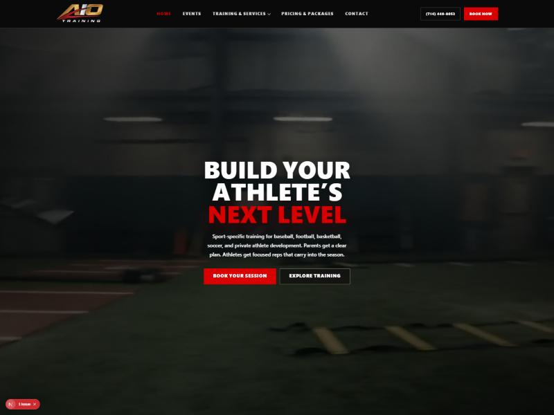
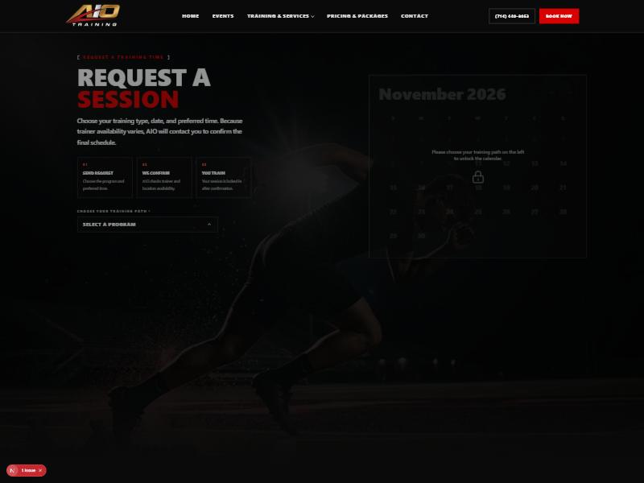

# AIO Training - Sports Training Booking Platform

> **Note:** The source code for this project lives in a private repository to protect the client. This repository is a portfolio showcase of the tech stack, features, and engineering behind the platform.

### [PLACEHOLDER: live site link once the domain goes live]

---

## Project Overview

AIO Training is a sports-training business that runs clinics, camps, and one-on-one sessions. They needed a platform that could sell spots in events and manage trainer availability on their own, without calling a developer every time a date or price changed.

I built them a full-stack booking platform from scratch. The public site presents clinics and events with a polished, dark, high-contrast look, and the registration flow takes a customer from an event page straight through Stripe Checkout. Behind a secure login, an admin dashboard lets staff manage bookings and schedules directly, so the business runs day to day without developer involvement.

The entire interface was hand-built rather than dropped in from a template, with a custom dark theme, red accents, and subtle scroll-triggered motion tuned to feel premium rather than flashy.

## Key Features

- **Event and clinic booking:** Customers browse clinics and events, open a detail page with a pinned flyer that tracks alongside the registration form, and register in a few steps.
- **Stripe Checkout:** Paid registrations run through Stripe, with server-side checkout session creation and webhook handling for confirmed payments.
- **Admin dashboard:** A protected area where staff manage bookings and trainer schedules in real time, with no code changes needed to update times, events, or availability.
- **Session-based auth:** Admin access is gated by signed session tokens (jose), keeping the management area private.
- **Conversion tracking and consent:** Meta Pixel integration paired with a privacy-respecting consent banner, so marketing data is gathered only after the visitor opts in.
- **Motion design system:** Scroll-triggered reveals site-wide (fade plus a short upward slide) using the Intersection Observer API, plus smooth momentum scrolling, built to stay subtle and performant.

## The Tech Stack

### Frontend
- **Framework:** Next.js 16 (App Router)
- **Library:** React 19
- **Language:** TypeScript
- **Styling:** Custom CSS design system (CSS variables, dark theme with red accents)
- **Motion:** Intersection Observer reveals and Lenis smooth scrolling

### Backend and Infrastructure
- **ORM:** Prisma 7
- **Database:** PostgreSQL in production, SQLite in local development
- **Payments:** Stripe Checkout and webhooks
- **Auth:** Session tokens via jose
- **Caching and rate limiting:** Upstash Redis
- **Media:** Vercel Blob storage
- **Hosting and analytics:** Vercel

## Platform Highlights

### The Public Site
A responsive, dark-themed experience built to scale cleanly from a 320px phone up to large desktop monitors, with a hero video, event listings, and detail pages where the flyer stays pinned while the registration form scrolls into view.

### The Booking Flow
A guided request flow walks the visitor through choosing a program, date, and preferred time, then hands off to Stripe Checkout for paid registrations.

## Engineering Highlights

1. **Pinned flyer detail pages:** Built a scroll interaction where the event flyer stays pinned beside the content and releases exactly when it reaches the registration form, tuned to feel smooth on iOS Safari.
2. **True responsive scaling:** Held a single approved layout that scales proportionally across every desktop width and stays flawless at 320 to 480px, with no cut-off content, horizontal scroll, or buttons touching screen edges.
3. **Subtle motion at scale:** Applied scroll-triggered reveals across the whole site with the Intersection Observer API, keeping the animation premium and performant rather than heavy or distracting.
4. **Owner-operable platform:** Designed the admin side so trainers and staff manage times, events, and bookings themselves, removing the developer from day-to-day operations.
